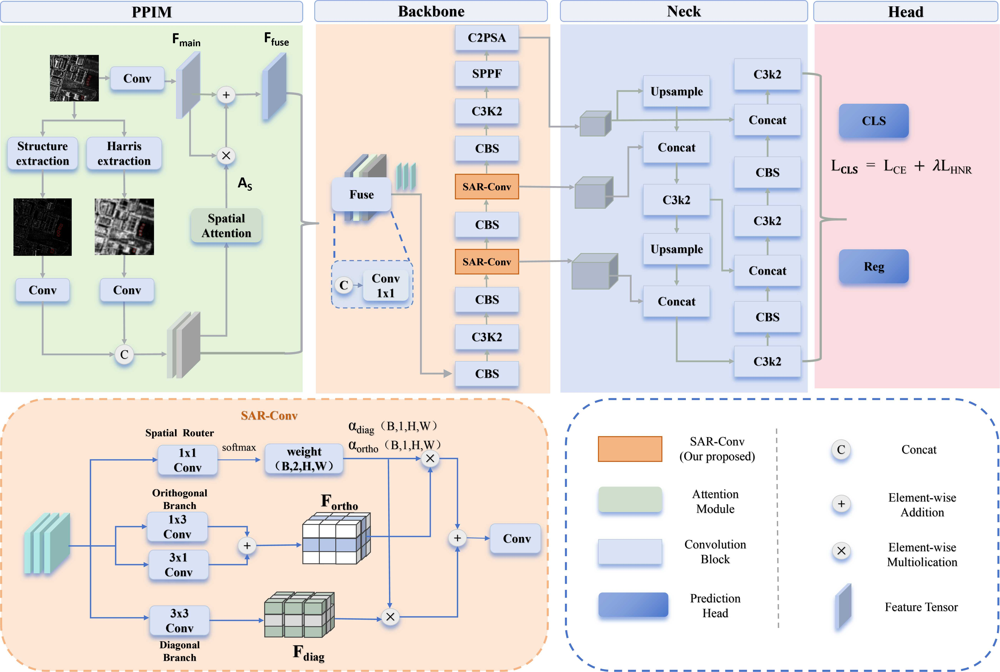

# MSP-RANet

[English](README.md) | 简体中文

**Multi-Source Scattering Prior Injection and Routing for Fine-Grained SAR Aircraft Detection**

MSP-RANet 面向 SAR 图像中的细粒度飞机旋转目标检测，基于 YOLOv11 引入多源散射先验与特征路由。本仓库提供定制模型、SAR 输入增强以及训练和评估实现，以下以 FAIR-CSAR 飞机子集的 12 类 OBB 检测配置为例介绍使用方法。

## 项目简介

- **PPIM**：通过 SAR 输入增强与 DualStreamStem，以残差注意力融合散射关键点、结构张量先验和图像特征。
- **SAR-Conv**：在 RAPC2f 中自适应路由正交与对角特征，提取方向性散射结构。
- **HNR**：在训练中增大真实类别与最易混淆错误类别之间的间隔。



| 内容 | 文件 |
| --- | --- |
| 模型配置（`s` 尺度、OBB 检测头） | [`yolo11-obb-rapconv.yaml`](ultralytics/cfg/models/11/yolo11-obb-rapconv.yaml) |
| 数据集与 SAR 增强配置 | [`coco_ence.yaml`](ultralytics/cfg/datasets/coco_ence.yaml) |
| DualStreamStem 与 RAPC2f 实现 | [`block.py`](ultralytics/nn/modules/block.py) |
| HNR 损失实现 | [`loss.py`](ultralytics/utils/loss.py) |

## 实验环境

原始实验在单张 NVIDIA GeForce RTX 4080 上完成，硬件平台及主要软件版本如下。

| 类别 | 配置 |
| --- | --- |
| GPU | NVIDIA GeForce RTX 4080，16 GB 显存 |
| CPU | Intel Xeon Gold 6230R，26 核 / 52 线程 |
| 操作系统 | Ubuntu 24.04.3 LTS（WSL2） |
| NVIDIA 驱动 | 572.70 |
| Python | 3.11.13 |
| PyTorch | 2.5.1+cu124 |
| torchvision / torchaudio | 0.20.1+cu124 / 2.5.1+cu124 |
| CUDA / cuDNN | 12.4 / 9.1.0 |
| Ultralytics | 8.3.111（本仓库定制源码） |

## 安装

安装 Conda 和 Git 后，在 Linux 或 WSL2 的 Ubuntu 终端中执行：

```bash
conda create -n msp-ranet python=3.11.13 pip=25.2 -y
conda activate msp-ranet
cd /path/to/yolov11_DualStreamStem
python -m pip install --no-deps -r requirement.txt
```

将项目路径替换为实际目录，后续命令均在**项目根目录**执行。

## 数据集准备

数据集下载：[fair-csar-craft.zip（百度网盘）](https://pan.baidu.com/s/1qg6gXwKw8ufjgGo9tfBt0g?pwd=4ajt)，提取码：`4ajt`。

将数据整理为以下目录结构，并保留原有划分：训练集 **2,008** 张、验证集 **465** 张、测试集 **404** 张。

```text
datasets/sar_aircraft/
├── images/
│   ├── train/
│   ├── val/
│   └── test/
└── labels/
    ├── train/
    ├── val/
    └── test/
```

图像与标签文件的主文件名应一致，例如 `images/train/0001.jpg` 对应 `labels/train/0001.txt`。每行标签表示一个旋转框，格式为类别编号与四个角点坐标：

```text
class_id x1 y1 x2 y2 x3 y3 x4 y4
```

`class_id` 从 `0` 开始；横坐标除以图像宽度、纵坐标除以图像高度，归一化至 `[0, 1]`，四个角点沿框边顺序排列。

修改 [`ultralytics/cfg/datasets/coco_ence.yaml`](ultralytics/cfg/datasets/coco_ence.yaml)，将原有的 `path`、`train`、`val`、`test` 全部替换为下列形式。`path` 使用实际数据集根目录的绝对路径，其余路径相对于该目录：

```yaml
path: /absolute/path/to/datasets/sar_aircraft
train: images/train
val: images/val
test: images/test

nc: 12
names:
  0: Airbus_A220
  1: Airbus_A320
  2: Airbus_A330
  3: Boeing737
  4: Boeing747
  5: Boeing767
  6: Boeing777
  7: Fokker-50
  8: Gulfstream
  9: Helicopter
  10: Airfreighter
  11: Other_Aircraft

sar_enhancement: true
sar_sigma_keypoint: 1.5
sar_sigma_tensor: 1.5
sar_clip_ratio: 2
```

## 训练

完成数据集路径配置后，运行 [`train.py`](train.py)：

```bash
python train.py
```

权重保存目录：`run/fair-csar/v11/weights/`。

## 测试

将待测权重放到 `run/fair-csar/v11/weights/best.pt`，运行 [`test.py`](test.py)：

```bash
python test.py
```

测试结果保存目录：`run/fair-csar/v11/test/`。

## 参考结果

原始实验参考指标：

| 数据划分 | mAP50 | mAP50–95 |
| --- | ---: | ---: |
| 验证集 | 80.1% | 63.6% |
| 测试集 | 47.7% | 35.5% |

## 致谢与许可

本项目基于 [Ultralytics YOLO](https://github.com/ultralytics/ultralytics) 开发，感谢其开源贡献。项目源码中的 AGPL-3.0 许可声明见 [`pyproject.toml`](pyproject.toml)。
